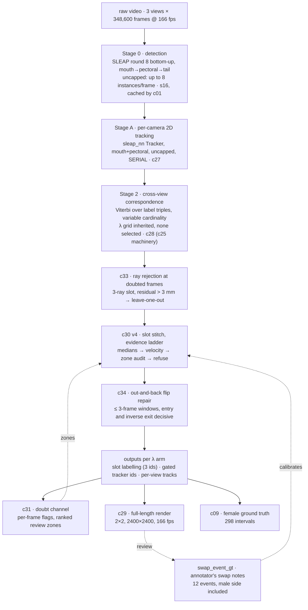

# The tracking pipeline as it stands

**Date:** 2026-09-08. **Status: nothing on this page is promoted.** `c03`
still owns the fixed output paths, the numbered tools under `tools/` are the
experiments, and `src/medaka3d/` holds only the pieces that have earned their
way in (`calib`, `reconstruct`, `track`, `track2d`, `correspond`). Every number
below is **one experiment, K_1_2** — 348,600 frames at 166 fps, 35 minutes,
three animals, one female with human identity annotation and two males with
none. `n_groups = 1` throughout. Where a number was measured on a particular
day, that day is named; the decisions that fixed each stage are linked, and
they hold the pre-registrations and the runs that were rejected.

This page replaces the 2026-08-24 version and its flow-chart companion. The
chain it describes was reached between 2026-08-29 and 2026-09-03, driven by
the experimenter's frame-by-frame review of full-length renders.

---

## The shape of the problem

Three synchronised cameras see a 192 × 192 × 186 mm volume (interior, from the
promoted refractive calibration) holding one female and two males. Nothing
leaves, so there are always exactly three animals. The pipeline answers two
different questions and they fail separately:

* **correspondence** — which detection in camera A is the same animal as which
  in camera B, *within* one frame;
* **identity** — which animal in frame *t* is which animal in frame *t+1*.

Most of the difficulty in this project has come from one being mistaken for
the other, and from a third confusion added on 2026-09-01: **two different
identity labels live in every output** (see "Two identities" below).

---

## Overall flow



Every stage after Stage 0 is re-run per arm of the **inherited lambda grid**
(0, 0.1, 0.25, 0.5, 0.767, 2, 8 mm). No lambda is chosen — the 2026-08-26
audit showed the pre-registered selector does not identify it — so **a claim
is carried only if it holds at every arm**. Renders draw the 0.767 arm; that
is a choice of what to look at, not of what to report.

---

## Two identities in every output — read this before any number

| label | what it is | on K_1_2 at λ 0.767 |
|---|---|---|
| `slot_track` | the **gated 3D tracker**'s id: links slots frame to frame, breaks at any step > 4.0 mm or gap > 73 frames | ~650 ids; **zero swaps** against the female annotation at every step of this project — the zero-swap *instrument* |
| the **slot** (column of `xyz`) | the correspondence's three columns, carried through time by λ continuity and repaired by `c30`/`c34` | **3 ids over 98.77% of frames** — what the render colours, and what a behaviour analysis would consume |

Until 2026-09-01 only `slot_track` was ever scored, and the slot labelling —
the thing the eye sees — turned out to swap the female in **24% of the
intervals** on the raw arm. Everything from `c30` onward is about the slot
labelling; `slot_track` is re-run after each repair and checked for not
getting worse. See
[2026-09-01 slot stitching](decisions/2026-09-01-slot-stitching.md).

---

## Stage 0 — detection

SLEAP round 8, bottom-up, three-node skeleton `mouth → pectoral → tail`,
inference by `s16`, cached by `c01` as flat arrays keyed by
`(experiment, view, frame_idx)`. **Uncapped**: up to eight instances per frame
(the retired repo ran with `max_instances = 6`; that limit was never here).

Per-node reliability (share of frames missing the node on some animal):
pectoral 3.9 / 6.3 / 5.3 %, mouth 6.7 / 10.3 / 9.1 %, tail 10.3 / 11.7 / 11.6 %
for top / side1 / side2. **Pectoral > mouth > tail in every view.** The tail
is also the node that merges between touching animals (`s10`), so it takes
part in nothing that decides identity; it is triangulated for display only.

Per-instance score and per-node positions are what the doubt channel reads.

---

## Stage A — per-camera 2D tracking (`c27`)

`sleap_nn.tracking.Tracker` on each camera separately, `oks` on
mouth + pectoral, **no cap on the number of tracks**, run **serially**.

Two facts fixed this stage, both 2026-08-25/26:

* Removing the old `max_tracks = 3` cap collapsed the reconstruction's residual
  tail 20× (p99.9 72.6 → 3.5 mm) and took unlabelled instances to zero. The
  cap had been forcing reflections into real animals' labels.
* The tracker's **chunked** parallel run is a different computation from the
  serial one (its candidate queue carries unbounded history); half the labels
  differ. Only the serial run isolates the cap, so only the serial run is used.
  Despite that, the reconstruction is nearly invariant to which run it reads —
  the slot carries identity, not the 2D label.

See [2026-08-25 uncapped tracklets](decisions/2026-08-25-uncapped-tracklets.md)
and [2026-08-26 stage A vs correspondence](decisions/2026-08-26-stage-a-vs-correspondence.md).

---

## Stage 1 — geometry (`medaka3d.calib`)

Refractive back-projection only: pixel → ray in water, with two interfaces for
the side cameras and one for the top. `triangulate(origins, directions,
valid=)` returns a point and a point-to-ray rms in mm, and can leave named
rays out. The calibration's own accuracy is 0.24 mm rms on held-out wet
checkerboards. World frame: x, y ∈ [0, 192], z ∈ [0, 186], surface at z = 186.

---

## Stage 2 — cross-view correspondence (`c28`, machinery in `c25`)

A Viterbi over the whole recording whose state at a frame is which 2D label
in each view occupies each of three slots — **variable cardinality**, so a
reflection is left in no slot rather than stealing one, and a (slot, node)
no two cameras support is charged μ = 4.0 mm. λ (mm) penalises a slot's label
triple changing between frames.

Per arm at λ 0.767: resolved 98.77 % of frames; 3-camera residual median
0.46 mm, p99.9 3.56 mm; 16,464 slot-label changes. Transfer to K_1_1 and K_1_3
holds for the residual tail and the zero-unlabelled property at every λ; day
differences are recorded, not scored
([2026-08-26 transfer](decisions/2026-08-26-transfer-to-k11-k13.md)).

**Known mechanism, measured at frame 333619 (2026-09-03):** when `top_cam`
intermittently drops one animal, the solver re-attaches top labels to the
side-view pairs; the (side1, side2) pairs themselves stay identical, but
which slot holds which pair permutes, and the two transition frames hold
mixed pairings — ghost triangulations, visible as a 45 mm there-and-back
teleport. The quantity that stays fixed across such a boundary (the
side1 → side2 map) names the camera that relabelled. Repaired downstream by
`c34`.

---

## `c33` — ray rejection at doubted frames

Only where the doubt channel points: a slot seen by **3 rays with residual
> 3.0 mm** (0.35 % of frames, capturing 93.7 % of out-and-back spikes).
Leave-one-out triangulation per view; the best drop is adopted only if its
residual is ≤ 1.5 mm and the runner-up is ≥ 1.0 mm worse. At λ 0.767:
1,344 flagged, 928 adopted, `top_cam` the dropped view most often (425).
Spikes 109 → 65, 3-ray residual > 3 mm 1,344 → 416, `resolved` unchanged.
Geometry only — labels untouched; the gated tracker and per-view tracks are
re-run because moved points move its breaks.
[2026-09-01 doubt channel](decisions/2026-09-01-doubt-channel.md), step 3.

---

## `c30` v4 — slot stitch, the evidence ladder

Repairs the slot labelling by re-permuting slots from a boundary onward. At
each candidate boundary, each step decides only where the one above could
not:

1. **Median rule** — 8-frame median positions before and after; join iff a
   non-identity assignment wins by > 5 mm. A one-frame spike cannot move an
   8-frame median.
2. **Velocity re-evaluation** — at step-1 refusals where the medians at least
   *lean* (margin ≥ 2.5 mm): extrapolate each slot 0.3 s forward; join iff
   the margin clears 5 mm and names the medians' permutation. This is the
   experimenter's criterion — *the one-frame displacement vector against the
   mean motion of the surrounding 0.1–0.3 s* — and it decided all four
   refused boundaries the female annotation later confirmed as swaps.
3. **Zone audit** — a turbulent zone (any view's best score < 1.5, ±2 frames,
   runs merged within 16 frames, containing a step > 20 mm) is audited once
   after the pass, clean end to clean end; a correction is applied only when
   position and velocity margins both exceed **30 mm** and agree. Everything
   inside such a zone may be fictitious geometry — the 31479 lesson.
4. **Refusal**, always recorded, including the paths v1 skipped silently.

v1 → v4 history, with the two failed versions and why, is in
[2026-09-01 slot stitching](decisions/2026-09-01-slot-stitching.md). The v4
thresholds (2.5 mm lean, 30 mm bridge) are **calibrated on this experiment's
annotated cases** and are hypotheses anywhere else.

---

## `c34` — out-and-back flip repair

The class the stitch is blind to by construction: a slot flip that decisively
reverts within ≤ 3 resolved frames. Entry assignment beats identity by > 5 mm,
its exact inverse does so at the exit, nothing else between; the permutation
is applied to the window only. 65 windows at λ 0.767 (94 % one-frame), all
three annotated transients repaired, steps > 30 mm 334 → 193, `c09` equal or
better at every λ. Doubt-channel decision, `c34` addendum.

---

## Where the pipeline stands — K_1_2, λ 0.767, chain `c27 → c28 → c33 → c30v4 → c34`

| quantity | raw arm (2026-08-29) | production chain (2026-09-03) |
|---|---|---|
| slot labelling vs female annotation, 298 intervals | 226 preserved / **72 swap** (24.2 %) | **296 preserved / 0 break / 2 swap** (0.7 %) |
| gated tracker vs the same | 269 / 29 / 0 | 272 / 26 / 0 |
| adjacent same-slot steps > 10 mm | 1,170 | 325 |
| adjacent same-slot steps > 30 mm | 674 | 197 |
| resolved frames | 98.77 % | 98.77 % |

Across the lambda grid the production chain's label swaps are
30/5/4/3/2/2/4 (λ 0 … 8) against 33/4/7/6/5/6/6 before v4; gated swaps
0/0/0/0/0/1/3 at every version since `c28`.

**The two remaining female swaps are both declared, not missed:** interval
76,698–77,285 is the boundary at 76930 refused at margins 3.26 / 3.85 mm
(below the bar), and 130,760–138,892 holds a 2,494-frame chaos zone whose
weak bridge (7.6 / 5.4 mm) is rejected and recorded as *unvouched*.

**What remains visible in the render (post-handling, measured 2026-09-08):**
81 adjacent steps > 10 mm in **29 scenes**, 14 steps > 20 mm in 5 scenes. Of
the 81, **40 sit on a 2-ray slot** (residual-blind: no redundancy, nothing to
reject) and 41 on 3-ray; **11 are exchange-type**, 70 spike-type. Plus 65
reappearances > 20 mm across unresolved gaps, a mixture of real motion and
hidden switches.

---

## The instruments

* **`c09`** — the female annotation: 299 anchors, 298 intervals (median gap
  6 s) of *preserved / break / swap* per arm. With three permanent slot ids a
  break is impossible, so every error is a swap. **`c09` writes to a fixed
  path**: run it with `--npz` per arm, then once with no `--npz` to restore
  the `c03` baseline (269 / 19 / 8) and verify it. **Swap counts of 0–8 rank
  nothing.**
* **`assets/groundtruth/swap_event_gt/`** — the experimenter's frame-by-frame
  swap notes on the 2026-09-01 render: 12 events with per-view judgements,
  the first male-side identity evidence in the project. Its female events
  matched `c09`'s five swaps **5 / 5**, independently. Slot ids in it are
  the annotated arm's; they do not transfer to other arms.
* **`c31` doubt channel** — per-frame flags from stored quantities:
  residual spike (3-ray > 3 mm), margin < 1.5 mm, ray-count change, per-view
  score < 1.5, per-view body-length wobble > 0.3, out-and-back spike,
  exchange boundary. `doubt` fires on 15.7 % of frames and **captured all 12
  annotated events**; 339 ranked zones, the largest being the handling
  period (0–5,121) and the second the stretch the experimenter had diagnosed
  by hand. A frame-level confidence is the instrument for experiments with no
  annotation.
* **Node-exchange evidence** (measured, not yet a flag): an instance's node
  landing nearer another instance's same node in the previous frame. Fires on
  1.3 % of frames, captures 88.1 % of exchange boundaries, names view and
  node; exchange rates order tail ≫ pectoral > mouth in every view.

---

## Tried and rejected — pointers, so nothing is re-run by accident

| idea | verdict | where |
|---|---|---|
| momentary view demotion, score-triggered, all views | disqualified — gated swaps rose at four λ | doubt channel, step 2 |
| the same, `top_cam` only (the proposal as made) | gate passed, label swaps rose at every λ; **repaired 31479** | doubt channel, step 2 |
| the same, wobble-triggered | gate passed, λ-dependent; **converted 31479's loud failure into a quiet exchange** — worse for review | doubt channel, wobble addendum |
| stitch v2: suppress all decisions inside turbulent zones | lost ~125 correct joins at λ 0.767; label swaps worse at every λ | slot stitching, v2 |
| stitch v3: zone audit with 5 mm bars | fixed four swaps, planted three (coin-toss velocity joins at 0.5–0.8 mm; bridges at 5–11 mm over long zones) | slot stitching, v3 |
| smoothing the score trigger over a window | capture 59 → 41 → 32 % at W = 3, 9; real degradation episodes last 1–3 frames | doubt channel, 2026-09-08 addendum |
| per-view static weight table | inverse-variance spread 1.25×, measures contamination not precision | `NEXT_SESSION_uncapped_followup.md`, step E |

---

## Known failure classes still open

1. **Sub-bar refusals** (76930): the join evidence leans the right way but not
   by 5 mm. Honest break; review queue.
2. **Long unvouched zones** (130,760–138,892): tens of seconds of churn where
   no clean-to-clean evidence can vouch. Review queue.
3. **2-ray misassignment** (30735): a stable detection of the *wrong* animal on
   a frame with no redundancy — invisible to residual, score and wobble alike;
   only occlusion-aware refusal can touch it. Half of the remaining big steps.
4. **Head-on bounce**: a lasting swap whose median comparison favours identity
   outright. Untested blind spot of the ladder.
5. **Quiet close-range exchanges**: an exchange completed through 3–4 mm
   steps while two animals fight. No jump detector sees it; the wobble
   demotion *produced* one. Appearance identity (the female is visually
   distinct) or human verdicts are the only known routes.

---

## Not yet built, in order of expected value

1. **Node-granular demotion** — mask only the exchanged node's ray (the
   node-exchange signal names view and node) instead of a whole view; the
   experimenter's "carry identity on the stable part". Needs pre-registration
   and the full λ grid.
2. **Doubt-driven blanking** of 2-ray contaminated frames to honest gaps
   (never interpolation).
3. **`c35`, human-verdict application** — read `swap_event_gt` as corrections
   and apply them, so a review pass becomes a fix.
4. **Transfer of the v4 thresholds** to K_1_1 / K_1_3, where no annotation
   exists: the doubt channel is the only instrument there.
5. Female-only appearance model — the one revival of the archived phase-2
   idea that scales, because it needs no per-experiment male training.

---

## Renders

`c29` draws all 348,600 frames at native resolution in a 2 × 2 grid (top,
side1, side2, 3D panel with a 5 s pectoral trail), 166 fps, thin marks, slot id
large and gated id small. Segment-parallel and proven identical to a serial
render (`--check-segmenting`); reader alignment is checked against `sleap_io`
per run. **Run names must identify the chain, not the file** — the c30 arms of
different chains share file names, and the 2026-09-01 render of one chain
overwrote another's state file before this was fixed; pass `--tag`.

Full-length videos on the bucket, each 25.4 GB, under `work/c29_full_render/`:

| chain | directory / file name | reviewed |
|---|---|---|
| `c28` raw | `lam0.767/…/c29__…__lam0.767__…` | 2026-08-29 |
| `c28 → c30 v1` | `C30-gated__…lam0.767/…/…chain-c28-c30…` | 2026-09-01 (four scenes diagnosed) |
| `c28 → c33 → c30 v1` | same directory, `…chain-c28-c33-c30…` | 2026-09-03 (12 swap events annotated) |
| `… → c34` | `chain-c28-c33-c30-c34/…` | — |
| **production, `… → c30 v4 → c34`** | `chain-c28-c33-c30v4-c34/…` | pending |

---

## The tools, as a chain

```
c01  cache s16 detections                  c29  full-length render (--npz, --tag)
c27  stage A, serial, uncapped              c30  slot stitch v4 (--arm-dir, --arm-prefix, --tag)
c28  correspondence over the λ grid         c31  doubt channel (--npz)
c33  ray rejection (--arm-dir, --tag)       c34  micro-flip repair (--arm-dir, --tag)
c09  female-annotation scoring (--npz; then bare, to restore)
```

Production chain, per experiment (each step writes under `work/<tool>/…`):

```
c27 → c28 → c33 --arm-dir c28/<exp> --arm-prefix C28-gated
    → c30 --arm-dir c33/<exp>__C28-gated --arm-prefix C33-gated --tag <chain>
    → c34 --arm-dir c30/<exp>__<chain> --tag <chain>
    → c09 --npz <c34 label and gated arms>, then c09 with no --npz
    → c29 --npz <c34 gated arm, one λ> --tag <chain>
```

Rejected variants keep their tools (`c32` demotion, with `--demote-views` and
`--trigger` as threshold choices, not algorithm switches) so their verdicts
stay reproducible.

---

## Traps

* **`c09` writes to a fixed path.** Restore after every batch; `c11`/`c14`/`c15`
  read that file.
* **Slot ids are per arm.** S0 in one chain's render is not S0 in another's.
  The annotation file records which npz it was made against.
* **Output names must carry the chain.** `c29`, `c30`, `c31`, `c33`, `c34` all
  take `--tag` for this reason.
* **A partial run never lands where a whole one does** — every tool with
  `--frames` puts the range in the leaf.
* **λ is drawn, never chosen.** Anything that holds at one arm only is
  λ-dependent and is recorded as such.
* **`n_groups = 1`.** K_1_1/2/3 are the same three fish on three days.
